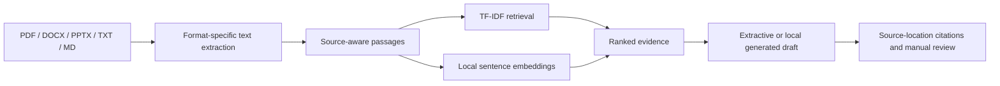

# Papertrail demo guide

## Live demo

[Open Papertrail](https://papertrail-lowkey.streamlit.app/)

## One-minute overview

Papertrail is a source-first research workspace for searching PDFs, Word and PowerPoint files, and plain text documents. It combines keyword retrieval with local sentence embeddings, keeps source-location citations, and lets readers compare evidence before reviewing an optional answer draft.

## Demo flow

1. Add two or three research documents in the sidebar and build the library index.
2. Enter a concept question using wording that differs from the papers, choose a retrieval method, and click **Search papers**. Compare **Semantic**, **TF-IDF**, and **Compare** to see where the rankings differ.
3. Open a result and verify its source location. Choose an extractive answer first, then try **Abstractive** and inspect every cited passage.
4. Mark the answer **Supported** or **Unsupported**. In **Evaluate retrieval**, add labeled questions or import a CSV set, then compare Hit@k, MRR, answer coverage, and abstention on questions the papers cannot answer.
5. For an image-only scan, re-index it with **OCR scanned pages** enabled.

## What to emphasize

- Retrieval is local after the models have downloaded; there is no API key requirement.
- Every passage stays attached to its source file and page, slide, or document passage.
- The answer generator receives retrieved passages and is instructed to cite them; readers should still check those citations against the paper.
- Documents and evaluation labels live in the Streamlit session. The Docker volume stores model files, not uploaded PDFs.
- Export labeled questions as CSV to keep a reusable evaluation set; imported filenames and location IDs must match the currently indexed documents.

## Evaluation CSV

After indexing the documents you want to evaluate, choose **Download evaluation CSV template** in **Evaluate retrieval**. Add one test question per row using these columns:

| Column | Meaning |
|---|---|
| `query` | The question or information need to search for |
| `source` | Exact uploaded filename containing relevant evidence; leave blank if unanswerable |
| `page` | One-based source location ID (PDF page, slide, or document passage); leave blank if unanswerable |
| `answerable` | `true` if the indexed papers support an answer, otherwise `false` |

If one question has relevant evidence at more than one source location, repeat its `query` on a separate row for each location. Papertrail groups those rows into one evaluation question and counts a hit when any labeled location is retrieved. For an unanswerable question, set `answerable` to `false` and leave `source` and `page` blank. Import the CSV into a session with the matching documents indexed. Papertrail checks that each answerable label points to an indexed source location, adds new cases, and skips duplicates. Keep the CSV file to reuse the labels in later sessions.

For a ready-made comparison, use the [two-paper Transformer starter set](data/evaluation/README.md). Download the linked arXiv PDFs, rename them to the filenames listed there, upload both into Papertrail, and import `data/evaluation/transformer_starter.csv`.

## Architecture

| Layer | Implementation |
|---|---|
| Document extraction | PyMuPDF for PDFs, python-docx, python-pptx, and text readers; source-aware overlapping passages |
| Keyword retrieval | scikit-learn TF-IDF and cosine similarity |
| Semantic retrieval | `sentence-transformers/all-MiniLM-L6-v2` embeddings |
| Answer drafts | Extractive sentence selection or local `google/flan-t5-small` generation |
| Evaluation | Manually labeled relevant pages, Hit@k, MRR, answerability, citation reviews |
| Interface and runtime | Streamlit, dual light/dark theme, Docker Compose |

## Run the demo

See [README.md](README.md) for local Python and Docker instructions. The Docker setup binds the app to localhost at [http://localhost:8501](http://localhost:8501). A remote host needs an access-controlled reverse proxy because Papertrail does not include sign-in.
