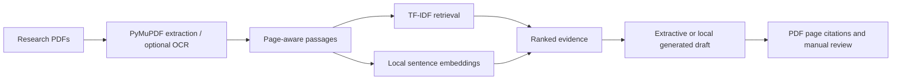

# Papertrail demo guide

## Live demo

[Open Papertrail](https://papertrail-lowkey.streamlit.app/)

## One-minute overview

Papertrail is a source-first research workspace for searching PDF papers. It combines keyword retrieval with local sentence embeddings, keeps page-level citations, and lets readers compare evidence before reviewing an optional answer draft.

## Demo flow

1. Add two or three research PDFs in the sidebar and build the library index.
2. Enter a concept question using wording that differs from the papers, choose a retrieval method, and click **Search papers**. Compare **Semantic**, **TF-IDF**, and **Compare** to see where the rankings differ.
3. Open a result and verify its source and page. Choose an extractive answer first, then try **Abstractive** and inspect every cited passage.
4. Mark the answer **Supported** or **Unsupported**. In **Evaluate retrieval**, add labeled questions or import a CSV set, then compare Hit@k, MRR, answer coverage, and abstention on questions the papers cannot answer.
5. For an image-only scan, re-index it with **OCR scanned pages** enabled.

## What to emphasize

- Retrieval is local after the models have downloaded; there is no API key requirement.
- Every passage stays attached to its source file and PDF page.
- The answer generator receives retrieved passages and is instructed to cite them; readers should still check those citations against the paper.
- Documents and evaluation labels live in the Streamlit session. The Docker volume stores model files, not uploaded PDFs.
- Export labeled questions as CSV to keep a reusable evaluation set; imported source filenames and page numbers must match the currently indexed PDFs.

## Evaluation CSV

After indexing the PDFs you want to evaluate, choose **Download evaluation CSV template** in **Evaluate retrieval**. Add one test question per row using these columns:

| Column | Meaning |
|---|---|
| `query` | The question or information need to search for |
| `source` | Exact uploaded PDF filename containing relevant evidence; leave blank if unanswerable |
| `page` | One-based PDF page number expected to be relevant; leave blank if unanswerable |
| `answerable` | `true` if the indexed papers support an answer, otherwise `false` |

For an unanswerable question, set `answerable` to `false` and leave `source` and `page` blank. Import the CSV into a session with the matching PDFs indexed. Papertrail checks that each answerable label points to an indexed source page, adds new cases, and skips duplicates. Keep the CSV file to reuse the labels in later sessions.

## Architecture

| Layer | Implementation |
|---|---|
| PDF extraction | PyMuPDF, page-aware overlapping passages, optional Tesseract OCR |
| Keyword retrieval | scikit-learn TF-IDF and cosine similarity |
| Semantic retrieval | `sentence-transformers/all-MiniLM-L6-v2` embeddings |
| Answer drafts | Extractive sentence selection or local `google/flan-t5-small` generation |
| Evaluation | Manually labeled relevant pages, Hit@k, MRR, answerability, citation reviews |
| Interface and runtime | Streamlit, dual light/dark theme, Docker Compose |

## Run the demo

See [README.md](README.md) for local Python and Docker instructions. The Docker setup binds the app to localhost at [http://localhost:8501](http://localhost:8501). A remote host needs an access-controlled reverse proxy because Papertrail does not include sign-in.
